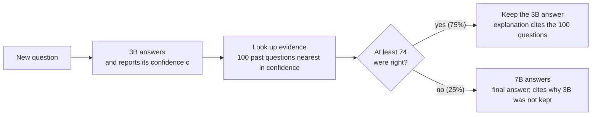
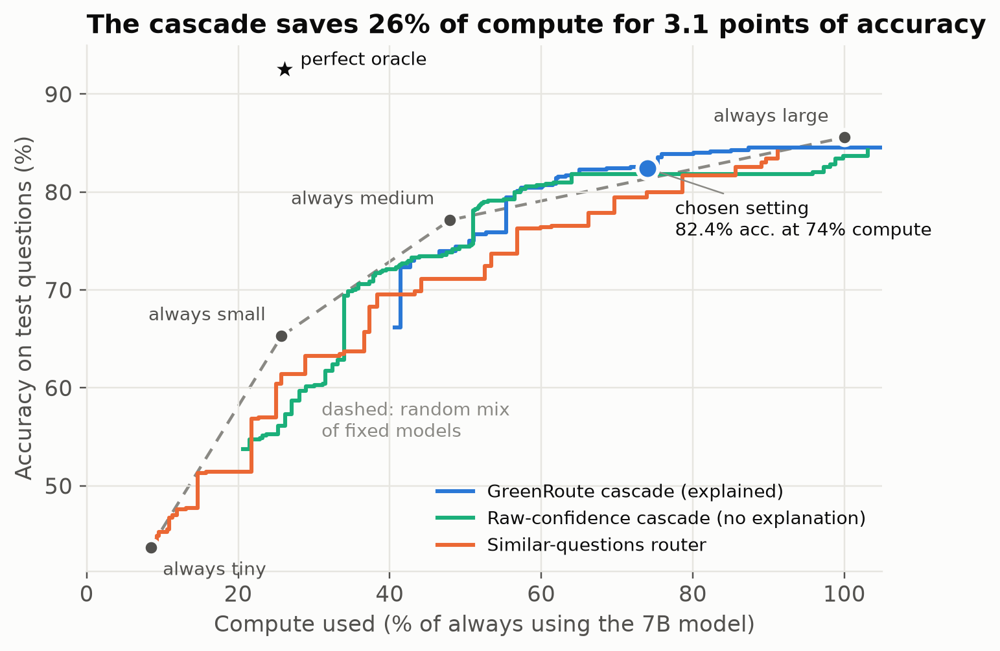
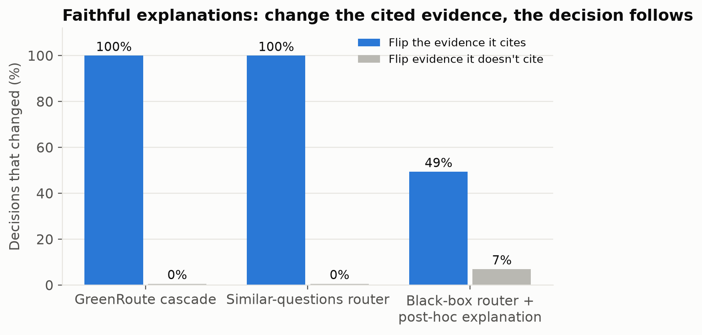

# GreenRoute: Faithful-by-Construction Explanations for Energy-Aware LLM Routing

**Ogechukwu Ezenwa** · AIPI 590: Explainable AI, Duke University · Fall 2026

*Written as a short workshop paper for two readers: ML engineers who run LLM services and need to justify cheaper routing to auditors, and XAI researchers interested in explanations that are faithful by construction.*

## Abstract

Sending every query to the largest available language model wastes energy, yet routers that save compute by choosing smaller models rarely explain their choices, and the explanations they do offer are seldom tested. We present GreenRoute, a confidence cascade whose decision rule *is* its explanation. A 3B model answers first; its answer is kept only if, among the 100 past benchmark questions on which that model was most similarly confident, it was right at least 74 times. Otherwise a 7B model answers. On 700 held-out questions from ARC-Easy, ARC-Challenge, MMLU and GSM8K, GreenRoute uses 26% less compute than always using the 7B model (FLOPs proxy) at a cost of 3.1 accuracy points (82.4% vs 85.6%). A counterfactual test confirms faithfulness: flipping the outcomes of the evidence an explanation cites changes the decision in 100% of cases, while flipping an equal number of uncited outcomes changes it in 0%. A black-box router paired with the same style of explanation scores 49% and 7%, showing that a plausible explanation is not necessarily a faithful one. We also find that topic similarity barely predicts which model will succeed (AUC 0.57 to 0.61), that small models are badly overconfident, and that compute savings did not translate into proportional wall-clock savings on our hardware (6%).

## 1 Introduction

Most questions sent to a large language model do not need it. In our data, a perfect router that always picked the cheapest model able to answer correctly would reach 92.6% accuracy while using only 26% of the compute of always calling a 7B model. Inference already dominates the energy cost of deployed models ([Luccioni et al., 2024](https://arxiv.org/abs/2311.16863)), so routing easy questions to smaller models is one of the most direct levers a practitioner has.

The obstacle is trust, not engineering. A router that silently sends a medical or legal question to a weaker model creates a risk that someone must sign off on. Learned routers such as RouteLLM ([Ong et al., 2024](https://arxiv.org/abs/2406.18665)) and Hybrid LLM ([Ding et al., 2024](https://arxiv.org/abs/2404.14618)) are black boxes: they output a decision but not a reason. Bolting a post-hoc explanation onto such a router is easy, but the explanation may not reflect what produced the decision, which is the faithfulness problem ([Jacovi & Goldberg, 2020](https://aclanthology.org/2020.acl-main.386/)).

We take the opposite path, following [Rudin (2019)](https://www.nature.com/articles/s42256-019-0048-x): make the router simple enough that its rule is the explanation. We ask three questions.

1. **RQ1: Efficiency.** How much compute can an explainable router save, and at what cost in accuracy?
2. **RQ2: Signal.** Which evidence actually predicts that a small model will succeed: what the question is about, or how confident the model is?
3. **RQ3: Faithfulness.** Do the explanations reflect the real cause of each decision, and can we show it with a test rather than assert it?

**Contributions.** (1) GreenRoute, a confidence cascade whose explanation is a count over cited past questions, faithful by construction. (2) A controlled evaluation on 1,000 questions, four model sizes from one family, and eight baselines, with leave-one-out evidence and a dev/test split. (3) A counterfactual faithfulness test that separates GreenRoute from a black-box router shown with an identical-looking explanation. (4) An honest failure analysis, including the gap between FLOPs saved and wall-clock time saved.

## 2 Related work

**Cascades and routers.** FrugalGPT ([Chen et al., 2023](https://arxiv.org/abs/2305.05176)) introduced LLM cascades: query a cheap model, score its answer, and escalate if the score is low. Later work routes *before* answering with learned classifiers (Hybrid LLM; RouteLLM) or uses answer consistency as the escalation signal ([Yue et al., 2024](https://arxiv.org/abs/2310.03094)). These systems optimize cost and accuracy. None treats the routing explanation as an object to evaluate. GreenRoute keeps the cascade structure but replaces the learned scorer with an evidence count a person can audit.

**Confidence and calibration.** Language models are often well calibrated on multiple-choice formats ([Kadavath et al., 2022](https://arxiv.org/abs/2207.05221)), but neural networks in general tend to be overconfident ([Guo et al., 2017](https://arxiv.org/abs/1706.04599)). Selective prediction abstains when confidence is low ([Geifman & El-Yaniv, 2017](https://arxiv.org/abs/1705.08500)); a cascade escalates instead of abstaining. Our evidence step is a local, empirical recalibration: rather than trusting a raw probability, it looks up how often that confidence level was actually right.

**Faithful explanations.** Jacovi and Goldberg (2020) separate *plausible* explanations (convincing to people) from *faithful* ones (reflecting the model's reasoning). Rudin (2019) argues that in high-stakes settings we should use models that are interpretable by design instead of explaining black boxes after the fact. Example-based explanations in the style of deep k-nearest neighbours ([Papernot & McDaniel, 2018](https://arxiv.org/abs/1803.04765)) cite training examples as evidence. GreenRoute is an example-based model that is interpretable by design, and we test its faithfulness with counterfactual perturbations of the cited evidence.

**Energy of inference.** [Strubell et al. (2019)](https://arxiv.org/abs/1906.02243) drew attention to the energy cost of NLP training, and Luccioni et al. (2024) measured inference energy across tasks and model sizes, finding that larger general-purpose models cost far more per query. We use a FLOPs proxy (2 × parameters per token, following [Kaplan et al., 2020](https://arxiv.org/abs/2001.08361)) and report wall-clock time beside it.

## 3 Method

**Model ladder.** We use four instruction-tuned models from one family, Qwen2.5 at 0.5B, 1.5B, 3B and 7B parameters ([Qwen Team, 2024](https://arxiv.org/abs/2412.15115)), served locally through Ollama with temperature 0 and a fixed seed. Using one family means differences in behaviour come from size, not training recipe.

**Evidence base.** Every model answers every one of 1,000 benchmark questions. For each answer we record whether it is correct and the model's confidence c: the joint probability of the answer tokens (the option letter or the digits) after the final "Answer:" cue, or 0 if the model gives no answer. These 4,000 records are the only thing the router consults.

**Decision rule.** A cascade tries models in a fixed order. At stage model m, with answer confidence c, let N_k(c) be the k evidence-base questions whose confidence under m is closest to c, excluding the question being routed. The answer is kept if

```math
\sum_{j \in N_k(c)} \mathrm{correct}_m(j) \;\geq\; \lceil \tau k \rceil
```

and otherwise the question moves to the next model. The last model's answer is always kept. Three settings are tuned: the stage order, k, and the accuracy bar τ. The final configuration, chosen on the dev split (Section 4), is 3B then 7B, k = 100 and τ = 0.74, so the bar is 74 of 100.

*Figure 1. The 3B answer is kept only when its past record at that confidence clears the bar.*



The explanation is not generated after the decision; it is the decision's own inputs, printed. For example, on the test question *"All of these elements are metals except…"* the explanation reads: "3B answered with 99.9999% confidence. On the 100 past questions where it was similarly confident, it was right 75 times (bar: 74), so its answer was kept." A user can open those 100 questions and check each outcome.

**Why confidence evidence and not raw confidence.** A raw threshold trusts the model's probability at face value. The evidence step asks a different question: at this confidence level, how often was this model *actually* right? That is a local, empirical recalibration, and it matters because the small models are overconfident (Section 5.3).

**First design: the similar-questions router.** Our initial router decided *before* answering. It embeds the question with all-MiniLM-L6-v2, retrieves the k = 10 most similar benchmark questions, and picks the smallest model that answered at least m of them correctly (tuned to m = 10), falling back to the 7B. It is equally transparent, so we keep it as a comparison; Section 5 shows why we replaced it.

## 4 Experimental setup

**Data.** 1,000 questions from four benchmarks: 400 from MMLU ([Hendrycks et al., 2021](https://arxiv.org/abs/2009.03300)), 300 from GSM8K ([Cobbe et al., 2021](https://arxiv.org/abs/2110.14168)), and 150 each from ARC-Easy and ARC-Challenge ([Clark et al., 2018](https://arxiv.org/abs/1803.05457)). The mix spans easy science recall, academic multiple choice and multi-step arithmetic.

**Protocol.** Two rules keep the evaluation honest.

- **Leave-one-out evidence.** Each question is routed using only the other 999 as evidence, never its own label.
- **Dev/test split.** A random 300 questions (seed 42) are used to tune every router. All reported numbers come from the remaining 700, which tuning never saw. Every router is tuned with the same rule: the cheapest dev setting whose accuracy is within 2 points of always using the 7B.

**Compute.** Our main cost measure is a FLOPs proxy: 2 × parameters × (prompt + output tokens), summed over every model a question passed through, divided by the cost of always using the 7B. A cascade that escalates pays for both models. We also report wall-clock time on the test machine (a MacBook laptop) relative to the 7B.

**Baselines.**

| Router | How it decides | Explanation |
| --- | --- | --- |
| Always one model (0.5B, 1.5B, 3B, 7B) | Fixed | None needed |
| Perfect oracle | Cheapest model that is correct (uses the answer key) | Upper bound, not deployable |
| Similar-questions router | Smallest model that solved all 10 nearest questions | Faithful: cites the 10 questions |
| Black-box router | Logistic regression per small model on question embeddings; smallest model with predicted success ≥ 0.85 | Post hoc: shown with the 10 nearest questions, which it does not use |
| Raw-confidence cascade | 0.5B, then 7B if confidence < 0.9999 | None: a bare threshold |
| **GreenRoute cascade** | 3B, then 7B unless 74 of 100 confidence-matched questions were right | Faithful: cites the 100 questions |

**Faithfulness test.** For each test question we perturb the evidence in two ways and check whether the decision changes. In the *cited* condition we flip the outcomes of the evidence the explanation cites so that it argues against the decision (for a kept small-model answer, correct becomes wrong; for an escalation, wrong becomes correct). In the *uncited* condition we flip the same number of outcomes on randomly chosen questions the explanation did not cite. A faithful explanation should give a high cited change rate and a near-zero uncited change rate. The black-box router receives identical perturbations: its classifier is refit on the flipped labels before it decides again.

## 5 Results

### 5.1 Efficiency (RQ1)

GreenRoute saves 26% of compute for 3.1 points of accuracy, recovering 35% of the savings a perfect oracle would get. Table 1 lists every router at its dev-tuned setting.

*Table 1. Test results (n = 700). Compute and time are relative to always using the 7B model.*

| Router | Accuracy | Compute | Time | Answered by 3B / 7B |
| --- | --- | --- | --- | --- |
| Always 0.5B | 43.7% | 8.5% | 21% | – |
| Always 1.5B | 65.3% | 25.7% | 49% | – |
| Always 3B | 77.1% | 48.0% | 71% | 100% / 0% |
| Always 7B | 85.6% | 100% | 100% | 0% / 100% |
| Perfect oracle | 92.6% | 26.1% | 44% | 12% / 5% |
| Similar-questions router | 83.0% | 89.0% | 91% | 16% / 80% |
| Black-box router | 83.1% | 81.1% | 88% | 31% / 64% |
| Raw-confidence cascade | 84.3% | 103.1% | 114% | 0% / 95% |
| **GreenRoute cascade** | **82.4%** | **74.0%** | **94%** | **75% / 25%** |

A single operating point can flatter or hide a method, so Figure 2 sweeps each router's settings and plots the best test accuracy reachable at each compute budget.



*Figure 2. Best test accuracy reachable at each compute budget (upper-left envelope of each router's settings sweep). Source: `results/cascade_sweep.csv`, `threshold_sweep.csv`, `sweep.csv`.*

The routers separate where it matters: near the 7B's accuracy. To stay within 2 points of the 7B, GreenRoute needs about 75% of the compute; the raw-confidence cascade needs about 98%, because to reach that accuracy it must send almost everything to the 7B. Below about 80% accuracy, both cascades trace nearly the same curve. The similar-questions router sits below the fixed models: it needs about 66% of the compute to match what the 3B alone achieves at 48%, so routing by topic before answering adds little.

### 5.2 What predicts success (RQ2)

The model's own confidence predicts whether its answer is right; topic similarity barely does. Table 2 reports the area under the ROC curve (AUC) for predicting each small model's correctness on all 1,000 questions; 0.50 is a coin flip.

*Table 2. AUC for predicting that a model's answer is correct.*

| Model | Similar questions (top 10) | Raw confidence | Confidence evidence (k = 50) |
| --- | --- | --- | --- |
| 0.5B | 0.57 | 0.64 | 0.61 |
| 1.5B | 0.59 | 0.70 | 0.68 |
| 3B | 0.61 | 0.73 | 0.72 |

Confidence evidence ranks questions almost as well as raw confidence, which is expected: it is a smoothed function of it. Its value is not better ranking but a better *threshold*: it turns an uninterpretable probability into a rate a person can read ("right 75 times in 100").

### 5.3 Small models are overconfident

The 1.5B model is more than 99.9% confident on 51.5% of all questions, yet right on only 79.0% of those. Raw probabilities are therefore nearly useless as thresholds: almost every answer clears a threshold of 0.999, so the raw-confidence cascade's dev tuning pushed it to 0.9999 and escalated 95% of questions. The evidence step corrects for this automatically. The same holds for the 3B: in our test set, even 99.9% confidence corresponded to only 58 correct answers in 100 past cases, and an answer was kept only above roughly 99.999%.

## 6 Are the explanations faithful? (RQ3)

Yes. Flipping the outcomes of the evidence GreenRoute cites changes its decision in 100% of test cases, and flipping an equal number of uncited outcomes changes it in 0%. The result is not surprising for a rule-based router, and that is the point: faithfulness here is a property of the design, and the test confirms the implementation matches the design.

The informative comparison is the black-box router. It is shown to users with exactly the same kind of explanation, its 10 most similar past questions and which models solved them, and the explanation looks just as plausible. Under the same perturbations its decision follows the cited evidence only 49% of the time, and it changes 7% of the time when evidence it never cited is flipped.



*Figure 3. Share of 700 test decisions that changed after flipping cited versus uncited evidence outcomes. Source: `results/metrics.json`.*

The black box's 49% is not zero because its classifier is trained on all questions, including the cited neighbours, so flipping them does move its prediction somewhat. Its 7% uncited change rate is the more damaging number: the decision depends on evidence the explanation never mentions. A user reading that explanation would form a wrong belief about why the router acted, which is exactly the failure Jacovi and Goldberg (2020) warn about. Plausibility and faithfulness come apart, and only a counterfactual test reveals it.

## 7 Failure analysis

The cascade's accuracy cost comes from 36 of 700 test questions (5.1%) where it kept a wrong 3B answer that the 7B would have answered correctly. Against that, on 14 questions the 3B's kept answer was right where the 7B would have been wrong, so the net loss is 22 questions, or 3.1 points. A further 87 questions were missed by both the cascade and the 7B.

*Table 3. Cascade results by benchmark (test split).*

| Benchmark | n | Kept 3B answer | Accuracy | Always 7B | Difference |
| --- | --- | --- | --- | --- | --- |
| MMLU (academic) | 290 | 58% | 73.8% | 77.2% | −3.4 |
| GSM8K (math) | 206 | 92% | 85.9% | 90.3% | −4.4 |
| ARC-Challenge (science) | 104 | 77% | 84.6% | 86.5% | −1.9 |
| ARC-Easy (science) | 100 | 87% | 98.0% | 99.0% | −1.0 |

Two patterns stand out.

- **GSM8K loses the most while keeping the most.** The 3B is extremely confident on arithmetic (its answer is a short string of digits, so the token probability is high), and 92% of math answers are kept. A confident wrong calculation looks the same as a confident right one to this signal. Per-benchmark evidence, or a bar that varies by task type, would likely help.
- **MMLU escalates the most and still loses accuracy.** The router correctly sends 42% of MMLU to the 7B, but the remaining confident 3B answers are still wrong more often than the 7B's would be. MMLU mixes 57 subjects, so a single confidence-to-accuracy mapping is coarse.

**A worked escalation.** On the test question *"Which of these is not found in a Snickers bar?"*, the 3B answered with 99.91% confidence, which sounds certain. But on the 100 past questions where it was that confident, it was right only 58 times, well below the bar of 74, so the question went to the 7B. A raw-confidence router with a 99.9% threshold would have kept this answer; the evidence step is what caught it, and the explanation tells the user why.

## 8 Discussion

**Explainability did not cost efficiency; here it helped.** It is often assumed that interpretable models trade performance for transparency. In our setting the opposite held: the step that makes the explanation readable (converting raw confidence into a past success rate) is also what lets the cascade set a sensible threshold. The unexplained raw-confidence cascade, given the same tuning budget, saved nothing at the target accuracy.

**FLOPs are not joules or seconds.** The cascade saves 26% of FLOPs but only 6% of wall-clock time on our laptop. The 3B runs at 71% of the 7B's time rather than 48%, because a small model does not use the hardware proportionally less, and every escalated question pays for both models. Energy savings in deployment will depend on hardware, batching and whether the two models share a server. Anyone reporting "green" routing should measure on the target system, not stop at FLOPs.

**Faithful is not the same as correct.** A faithful explanation tells you the true reason for a decision, including when that reason is wrong. The GSM8K failures in Section 7 come with honest explanations: "the 3B was right 75 of 100 times at this confidence" is true, and this question was one of the 25. Faithfulness makes these errors auditable; it does not prevent them.

### Recommendations for practitioners

1. Prefer a post-answer signal (the model's own confidence) over pre-answer topic matching for routing decisions.
2. Never threshold raw token probabilities from small models; map them to empirical success rates first.
3. If a router's explanation is going to be shown to users or auditors, test it counterfactually. A plausible explanation can be unfaithful, as the black-box router shows.
4. Report wall-clock time or metered energy beside FLOPs.

### Limitations

- **Scope.** Four benchmarks, one model family, and 1,000 questions. The results show the idea in a controlled setting, not readiness for deployment.
- **Compute proxy.** FLOPs on one laptop, not metered energy.
- **Distribution shift.** The evidence comes from benchmark-style prompts. For free-form questions, as in our demo, the evidence is a guide rather than a guarantee.
- **No user study.** We measure faithfulness, not whether people understand or appropriately trust the explanations. A study of how users act on them is the natural next step.
- **Single seed.** Results use one dev/test split (seed 42); we did not report variance across splits.

## 9 Conclusion

A router can save compute and still give an explanation that is provably its real reason. GreenRoute cuts compute by 26% at a cost of 3.1 accuracy points. Its explanations pass a counterfactual faithfulness test that a black-box router with identical-looking explanations fails. The broader lesson for explainable AI is that faithfulness can be designed in rather than hoped for, and that it should be tested rather than asserted. The broader lesson for green AI is that FLOPs saved are only a first estimate of energy saved.

**Reproducibility.** Code, labels, results and a live demo are in this repository. Decoding is deterministic, so `scripts.evaluate` and `scripts.make_figures` regenerate every number and figure in this paper in about a minute from the stored labels.

## References

- Chen, L., Zaharia, M., & Zou, J. (2023). [FrugalGPT: How to use large language models while reducing cost and improving performance](https://arxiv.org/abs/2305.05176). arXiv:2305.05176.
- Clark, P., et al. (2018). [Think you have solved question answering? Try ARC, the AI2 Reasoning Challenge](https://arxiv.org/abs/1803.05457). arXiv:1803.05457.
- Cobbe, K., et al. (2021). [Training verifiers to solve math word problems](https://arxiv.org/abs/2110.14168). arXiv:2110.14168.
- Ding, D., et al. (2024). [Hybrid LLM: Cost-efficient and quality-aware query routing](https://arxiv.org/abs/2404.14618). ICLR 2024.
- Geifman, Y., & El-Yaniv, R. (2017). [Selective classification for deep neural networks](https://arxiv.org/abs/1705.08500). NeurIPS 2017.
- Guo, C., Pleiss, G., Sun, Y., & Weinberger, K. Q. (2017). [On calibration of modern neural networks](https://arxiv.org/abs/1706.04599). ICML 2017.
- Hendrycks, D., et al. (2021). [Measuring massive multitask language understanding](https://arxiv.org/abs/2009.03300). ICLR 2021.
- Jacovi, A., & Goldberg, Y. (2020). [Towards faithfully interpretable NLP systems: How should we define and evaluate faithfulness?](https://aclanthology.org/2020.acl-main.386/) ACL 2020.
- Kadavath, S., et al. (2022). [Language models (mostly) know what they know](https://arxiv.org/abs/2207.05221). arXiv:2207.05221.
- Kaplan, J., et al. (2020). [Scaling laws for neural language models](https://arxiv.org/abs/2001.08361). arXiv:2001.08361.
- Luccioni, A. S., Jernite, Y., & Strubell, E. (2024). [Power hungry processing: Watts driving the cost of AI deployment?](https://arxiv.org/abs/2311.16863) ACM FAccT 2024.
- Ong, I., et al. (2024). [RouteLLM: Learning to route LLMs with preference data](https://arxiv.org/abs/2406.18665). arXiv:2406.18665.
- Papernot, N., & McDaniel, P. (2018). [Deep k-nearest neighbors: Towards confident, interpretable and robust deep learning](https://arxiv.org/abs/1803.04765). arXiv:1803.04765.
- Qwen Team (2024). [Qwen2.5 technical report](https://arxiv.org/abs/2412.15115). arXiv:2412.15115.
- Rudin, C. (2019). [Stop explaining black box machine learning models for high stakes decisions and use interpretable models instead](https://www.nature.com/articles/s42256-019-0048-x). Nature Machine Intelligence, 1, 206–215.
- Strubell, E., Ganesh, A., & McCallum, A. (2019). [Energy and policy considerations for deep learning in NLP](https://arxiv.org/abs/1906.02243). ACL 2019.
- Yue, M., Zhao, J., Zhang, M., Du, L., & Yao, Z. (2024). [Large language model cascades with mixture of thoughts representations for cost-efficient reasoning](https://arxiv.org/abs/2310.03094). ICLR 2024.
